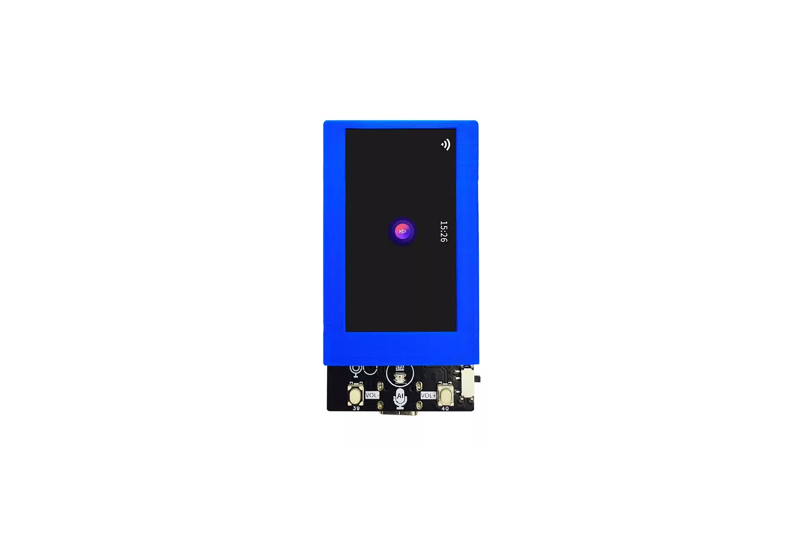

# WiFiduino ESP32-S3 CBot19 AI Development Board

A compact ESP32-S3 development board for voice-driven interfaces, AI experiments, and IoT prototypes. The CBot19 combines a 1.9-inch color display, onboard microphone, and audio decoding/amplification circuitry in a 63.5 × 33 mm board.

## Highlights

- ESP32-S3-WROOM-1 module, N16R8 (16 MB flash and 8 MB PSRAM)
- 1.9-inch IPS TFT display, 170 × 320, driven by ST7789
- Onboard microphone and audio decoder/amplifier
- USB-C 5 V input; MX1.25 2-pin connector for a 3.7 V Li-ion/LiPo battery
- WS2812 addressable RGB status LED
- I²C and UART expansion interfaces, plus accessible GPIO
- Reset, Boot, volume-up, and volume-down buttons
- Approximate board dimensions: 63.5 × 33 mm

## Getting started

See [Getting Started](docs/getting-started.md) for the summarized setup paths and links to the original tutorials and firmware.

## Package options

The source product listing shows two configurations. Confirm the selected option before ordering:

- **Board bundle:** board, protective screen cover, and USB data cable.
- **Speaker and battery bundle:** board, protective screen cover, speaker, 3.7 V battery, and USB data cable.

Battery inclusion can affect international shipping. Check the shipping option and destination restrictions before ordering a battery bundle.

## Images

Product photos are in [`images/`](images/), prepared for a 3:2 product-gallery layout.

## Sources

- Product hardware and setup article: [ESP32S3AI board (Arduino 中文社区)](https://arduino.me/a/3274) (Chinese; access to some community features may require sign-in). The article is marked as original and prohibits republication; this repository provides an independently written summary of hardware facts and links back to the source.
- Original product listing: [Tmall item 990762040739](https://detail.tmall.com/item.htm?id=990762040739)

Board specifications and package contents are summarized from the sources above. The source article does not provide a schematic file in its publicly readable content; no schematic or source code is included here.
